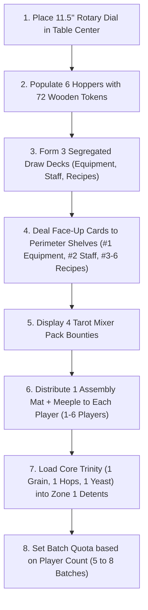
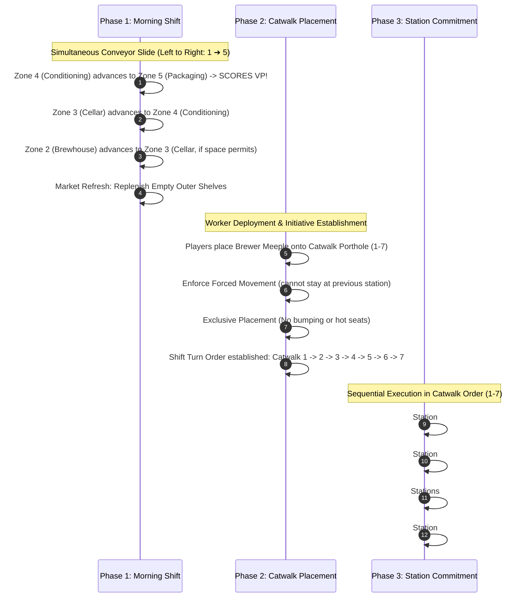

# House of Hoyne: The Brewhouse Dial Edition
## Official Tabletop Rulebook & Complete Operations Manual
*A Craft Brewery Strategy Game for 1 to 6 Players • Ages 14+ • 45–90 Minutes*  
*Designed in Celebration of Hoyne Brewing Company — 2740 Bridge Street, Victoria, British Columbia*

---

> *"Beer is a conversation between friends, a celebration of community, and a testament to patience. Welcome to the brewhouse."*  
> — **Sean Hoyne**, Master Brewer & Founder

---

## 1. Overview, Lore & Theme

In the historic industrial district of Rock Bay in Victoria, British Columbia, the scent of boiling wort, crushed two-row barley, and fresh Pacific Northwest hops drifts along Bridge Street. Here stands **Hoyne Brewing Company**, an institution founded in 2011 by Canadian craft brewing pioneer Sean Hoyne after decades of honing his craft at Swans and Spinnakers.

In **House of Hoyne: The Brewhouse Dial Edition**, 1 to 6 players step into the boots of rival Victoria brewmasters competing across grueling production shifts to establish the most prestigious craft brewery on Vancouver Island.

The centerpiece of your operation is the **11.5″ Circular Rotary Brewhouse Dial**—an authentic industrial control wheel modeling the physical movement of workers, grain deliveries, and recipe commitments. Surrounding the dial are player assembly lines: 5-zone modular factory floor mats modeling grain intake, copper kettle boils, cold cellar fermentation, pressurized conditioning, and high-speed packaging.

To claim the mantle of Master Brewer, you must source raw agricultural tokens, manage pipeline throughput without causing catastrophic cellar gridlock, hire experienced brewery floor staff, install permanent hardware upgrades, and deliver beloved Victoria classics—from the crushable *Hoyne Pilsner* and *Down Easy Pale Ale* to the legendary *Dark Matter* and seasonal *Gratitude Winter Ale*.

---

## 2. Complete Component Manifest (1–6 Players)

Every copy of *House of Hoyne: The Brewhouse Dial Edition* comes equipped with heavy-duty components tailored specifically to support competitive and solo play from **1 to 6 players**:

| Component | Quantity | Specifications & Physical Properties |
| :--- | :---: | :--- |
| **9.25″ Rotary Brewhouse Dial** | 1 | Dual-layer 3mm linen-finish greyboard with recessed brass portholes, 6 radial station wedges (#1–6), central Brewhouse Pantry (#7), 6 Inner Hoppers, and 6 Outer Perimeter Card Shelves. |
| **Player Assembly Line Mats** | 6 | 12″ × 4.5″ dual-layer punchboards featuring 5 distinct operational columns with recessed token detents and card-tuck gutters. Supports 1 to 6 players. |
| **Wooden Brewer Meeples** | 6 | 38mm × 38mm × 10mm custom silk-screened hardwood worker meeples in 6 distinct player colors (*Pilsner Gold, Cascade Green, Dark Matter Brown, Belgian Red, Solstice Violet, Alpine Cream*). |
| **Tactile Wooden Ingredient Tokens** | 72 | 100% FSC-certified hardwood tokens in 6 distinct taxonomy shapes and colors (20 Grain, 16 Hops, 12 Yeast, 8 Fruit, 8 Spices, 8 Chocolate). Closed-loop supply pool. |
| **Craft Beer Recipe Cards** | 57 | Standard Poker (2.5″ × 3.5″), 310gsm German black-core linen cards across 3 Tiers (24 Tier 1 Core Crushers, 27 Tier 2 Showstoppers, 6 Tier 3 Seasonals). |
| **Dedicated Equipment Cards** | 20 | Standard Poker (2.5″ × 3.5″), Station #1 Market Deck. Permanent hardware infrastructure with printed storage detents and cost-reduction badges. |
| **Dedicated Staff Cards** | 20 | Standard Poker (2.5″ × 3.5″), Station #2 Market Deck. Dedicated brewery floor personnel with active drafting and spent-token recovery perks. |
| **Mixer Pack Bounty Cards** | 4 | Tarot-Sized (2.75″ × 4.75″) heavy cardstock public race bounties (*In Good Time, Four Fine Friends, Hello Sunshine, Hello Darkness*). |
| **First Brewer Marker** | 1 | Embossed solid brass steam whistle marker. |
| **Production Pad & Rulebook** | 1 | Double-sided 50-sheet scoresheet pad and publication-grade technical rulebook. |

```
                       [ 11.5" ROTARY BREWHOUSE DIAL ]
                                Station #1: Chocolate
                                      (12:00)
                     Station #6: Grain       Station #2: Spices
                          (10:00)                 (02:00)
                                    \   |   /
                                  [Station #7]
                                   WILD PANTRY
                                  (Center Hub)
                                    /   |   \
                     Station #5: Hops        Station #3: Fruit
                          (08:00)                 (04:00)
                                 Station #4: Yeast
                                      (06:00)
```

---

## 3. Setup Guide for 1 to 6 Players

Follow these steps to prepare the tabletop for a shift at Hoyne Brewing Co.:



### Step 1: Central Rotary Dial & Hoppers
1. Lay the **9.25″ Rotary Brewhouse Dial** flat in the center of the table.
2. Sort the **72 Tactile Wooden Ingredient Tokens** by type and deposit them directly into their matching recessed **Inner Hoppers**:
   - **Station #1 (Chocolate)**: 8 Roasted Dark Malt Rectangles (Cocoa Brown)
   - **Station #2 (Spices)**: 8 Winter Spice Cubes (Crimson Red)
   - **Station #3 (Fruit)**: 8 Saanich Raspberry Pellets (Deep Purple)
   - **Station #4 (Yeast)**: 12 House Yeast Cylinders (Pale Gold / Cream)
   - **Station #5 (Hops)**: 16 Cascade Hop Cones (Forest Emerald Green)
   - **Station #6 (Grain)**: 20 Two-Row Barley Octagons (Harvest Gold)
   *(Station #7 Brewhouse Pantry is a central porthole and draws from any available hopper).*

### Step 2: Segregated Market Decks & Perimeter Shelves
The Rotary Dial utilizes strict market segregation. Do not combine these decks:
1. **Equipment Deck (Station #1)**: Shuffle the 15 Equipment Cards and place the deck face-down beside Station #1. Deal **1 card face-up** onto the outer shelf of Station #1.
2. **Staff Deck (Station #2)**: Shuffle the 15 Staff Cards and place the deck face-down beside Station #2. Deal **1 card face-up** onto the outer shelf of Station #2.
3. **Beer Recipe Deck (Stations #3–6)**: Shuffle the 57 Recipe Cards and place the deck face-down beside Stations #3–6. Deal **1 card face-up** onto each of the outer shelves of **Station #3, Station #4, Station #5, and Station #6** (4 recipe cards total).

### Step 3: Public Mixer Pack Bounties
Lay the **4 Mixer Pack Bounty Cards** (*In Good Time, Four Fine Friends, Hello Sunshine, Hello Darkness*) face-up in a central row accessible to all players.

### Step 4: Player Area & Starting Core Trinity (1–6 Players)
1. Each player receives **1 Player Assembly Line Mat** and the matching **Wooden Brewer Meeple** (up to 6 players).
2. Place the mat directly in front of the player.
3. **The Core Trinity**: Each player takes **1 Grain**, **1 Hops**, and **1 Yeast** token from the central hoppers and seats them into the recessed detent slots in **Column 1: Zone 1 (Grain Warehouse)**.
4. The player who most recently visited a craft brewery or poured a pint receives the **First Brewer Whistle**.

### Step 5: Establish the Endgame Batch Target
The number of completed batches required to trigger Last Call depends on the total player count:

| Player Count | Batch Completion Target | Estimated Duration |
| :---: | :---: | :---: |
| **6 Players** | **5 Batches** | 75–90 min |
| **5 Players** | **6 Batches** | 60–75 min |
| **4 Players** | **7 Batches** | 50–65 min |
| **3 Players** | **8 Batches** | 45–60 min |
| **2 Players** | **8 Batches** | 40–50 min |
| **1 Player (Solo)** | **8 Batches** | 35–45 min |

---

## 4. Core Tabletop Architecture

*House of Hoyne* eliminates bookkeeping through tactile physical components and rigid physical constraints.

```
+-------------------------------------------------------------------------------------------------------+
|                                    PLAYER ASSEMBLY LINE MAT                                           |
+---------------------+-------------------+---------------------+---------------------+-----------------+
|      COLUMN 1       |     COLUMN 2      |      COLUMN 3       |      COLUMN 4       |    COLUMN 5     |
|       ZONE 1        |      ZONE 2       |       ZONE 3        |       ZONE 4        |     ZONE 5      |
|   GRAIN WAREHOUSE   |     BREWHOUSE     |     FERMENTATION    |    CONDITIONING     | PACKAGING & DOCK|
|                     |      KETTLE       |        CELLAR       |     & LAGERING      |  (TROPHY RACK)  |
+---------------------+-------------------+---------------------+---------------------+-----------------+
| [O] [O] [O]         | [   BREW WORT   ] | [   FERMENT BEER  ] | [  CONDITION BEER ] | [ DELIVER BEER ]|
| [O] [O] [O]         | (Mash & Boil Tun) | (Cellar Carboys)    | (Lagering Tanks)    | (Loading Dock)  |
| 6 Base Detents      | Cap: 1 Batch      | Base Cap: 1 Batch   | Cap: 1 Batch        | VP Scored Here! |
| (Expandable)        |                   | (2 with Glycol)     |                     | Endgame Trigger |
+---------------------+-------------------+---------------------+---------------------+-----------------+
|  Hardware Blueprints| Mash Tun Reductions| Foeder Kickbacks   | Lagering Perks      | Keg & Delivery  |
|  & Sourcing Brokers | & Grist Recovery  | & Yeast Harvesting  | & Cold Maturation   | Paydays         |
+---------------------+-------------------+---------------------+---------------------+-----------------+
```

### The Zero-Hand Invariant
Players never hold private card hands. All resources are 100% public, visible, and tangible:
- **Tokens** sit exclusively in physical recessed detent circles on player mats or on installed hardware cards.
- **Recipes** advance physically across the 5 columns from right to left as wort boils, ferments, conditions, and packages.
- **Upgrades** (Hardware Equipment and Staff Personnel) sit face-up above and below their assigned zones.

### The 5 Operational Pipeline Columns
1. **Column 1: Zone 1 (Grain Warehouse & Sourcing)**
   - Houses **6 base recessed token detent slots** for raw materials.
   - Expandable up to 12+ detents via installed hardware (*High-Capacity Hopper, Cryo-Hop Storage, Roasted Malt Bin, Cold Distribution Vault*).
   - Base hand/token storage limit is strictly 6 tokens unless expanded.
2. **Column 2: Zone 2 (Brewhouse Kettle)**
   - The copper mash tun and boil kettle where new recipes are brewed.
   - **Batch Capacity: Exactly 1 Recipe Card (1 BBL)**. You cannot brew a new recipe if your kettle is currently occupied by unboiled wort!
3. **Column 3: Zone 3 (Fermentation Cellar)**
   - Stainless fermentation vessels where yeast converts sugars into alcohol.
   - **Base Capacity: Exactly 1 Recipe Card (1 BBL)**. Installing the *Glycol Chilling Jacket* expands capacity to 2 Batches.
   - **Pipeline Bottleneck**: If the cellar is full, wort in Zone 2 cannot advance during the Morning Shift.
4. **Column 4: Zone 4 (Conditioning & Lagering)**
   - Horizontal lagering tanks where beer matures, clarifies, and carbonates.
   - **Capacity: Exactly 1 Recipe Card (1 BBL)**.
5. **Column 5: Zone 5 (Packaging & Loading Dock / Trophy Rack)**
   - Automated canning and kegging lines where beer is prepped for retail distribution.
   - Completed beers slide here during the Morning Shift, immediately scoring their Prestige VP and recipe bonuses.
   - Reaching your player count's batch target in Column 5 triggers the endgame!

---

## 5. The 3-Phase Shift Structure

A complete round represents one production shift at Hoyne Brewing. Every shift follows three mandatory phases:



---

### Phase 1: The Morning Shift (Conveyor Slide & Market Refresh)

All players simultaneously advance their active brewing pipeline from left to right across their 5-Zone Assembly Line Mat (1 ➔ 2 ➔ 3 ➔ 4 ➔ 5).

#### Step 1.1: Advance to Packaging (Column 4 ➔ Column 5)
- Any recipe currently in **Column 4 (Conditioning & Lagering)** advances directly into **Column 5 (Packaging & Loading Dock)**.
- **Scoring**: The player immediately earns the recipe's printed **Prestige Victory Points (VP)** and applies any instant completion bonus text.
- **Delivery Equipment Triggers**: Equipment cards such as *Automated Keg Racker* (+1 Grain & +1 Yeast) or *Pallet Stretch Wrapper* (retain 1 spent token) fire now.
- **Endgame Check**: If this delivery causes the player's total completed batches in Column 5 to meet or exceed the target quota, the **Endgame is Triggered**!

#### Step 1.2: Advance to Conditioning (Column 3 ➔ Column 4)
- If **Column 4** is empty, the oldest recipe in **Column 3 (Fermentation Cellar)** advances into **Column 4 (Conditioning & Lagering)**.
- Cellar kickback equipment (such as the *Conical Unitank* or *Oak Aging Foeder*) immediately awards bonus tokens when a beer exits the cellar.

#### Step 1.3: Advance to Fermentation (Column 2 ➔ Column 3)
- If **Column 3 (Fermentation Cellar)** has available capacity (Base: 1 batch; 2 batches if *Glycol Jacket* is installed), the recipe in **Column 2 (Brewhouse Kettle)** advances into Column 3.
- > [!IMPORTANT]
  > **The Brewhouse Bottleneck**: If Column 3 is already full, the wort in Column 2 **cannot move**. It remains locked in the kettle. Because Column 2 holds a maximum of 1 card, the player **cannot brew any new recipes** during Phase 3 until their cellar clears!

#### Step 1.4: Market Refresh & Gridlock Wipe
- Refill all empty outer perimeter shelves on the 11.5″ Rotary Dial:
  - **Station #1**: Draw from the Equipment Deck until 1 card is face-up.
  - **Station #2**: Draw from the Staff Deck until 1 card is face-up.
  - **Stations #3–6**: Draw from the Beer Recipe Deck until each station has 1 card face-up.
- **The Gridlock Wipe Rule**: If all 4 recipe cards on Stations #3–6 remain unpurchased across an entire shift and players are unable or unwilling to draft them, any player may call a **Brewhouse Flush** at the start of Phase 1. Discard all 4 face-up recipes to the recipe discard pile and deal 4 fresh recipes.

---

### Phase 2: Catwalk Placement & Shift Initiative

In initial turn order (or clockwise starting with the First Brewer Whistle), players take turns deploying their **Wooden Brewer Meeple** to an available **Catwalk Porthole (Stations 1 to 7)**.

```
       [CATWALK PORTHOLES: SHIFT INITIATIVE RESOLUTION ORDER]
  (#1 Chocolate) ➔ (#2 Spices) ➔ (#3 Fruit) ➔ (#4 Yeast) ➔ (#5 Hops) ➔ (#6 Grain) ➔ (#7 Pantry)
     [Acts 1st]      [Acts 2nd]     [Acts 3rd]     [Acts 4th]     [Acts 5th]    [Acts 6th]     [Acts Last]
```

#### Rule 2.1: The Forced Movement Rule
A brewer meeple can **never** remain at the same station for two consecutive shifts. On your turn, you must vacate your previous station and select a different Catwalk Porthole.

#### Rule 2.2: Exclusive Catwalk Placement & Shift Initiative

In this refined operational edition of *House of Hoyne*, catwalk positions are **mutually exclusive worker spots**:

1. **Exclusive Worker Spots**:
   - Each brass **Catwalk Porthole (1–7)** accommodates exactly one Brewer Meeple.
   - Once a player deploys to a catwalk station, that station is blocked for all other players for the rest of Phase 2.
   - There are **no evictions, hot seats, or bumping**.

2. **Standard Clockwise Phase 2 Order**:
   - Players deploy their 1 Brewer Meeple one at a time, proceeding strictly clockwise around the table.
   - If a station is already occupied, you must choose another open station.

3. **Mandatory Movement Rule**:
   - You must always move your Brewer Meeple to a **different station** on every shift.
   - A player can **never** remain at the same station (including Station #7 Pantry) for two consecutive rounds!

#### Rule 2.3: Establishing Shift Turn Initiative
Once all players (from 1 up to 6) have deployed their meeples to either Catwalks or their personal Brewery Departments, turn order for the remainder of the shift is locked.
- **Two-Tier Initiative Order**:
  - **Tier 1 (Public Catwalks First)**: All players who deployed to Rotary Catwalks resolve first, strictly in numerical catwalk order (**1 ➔ 7**).
  - **Tier 2 (Private Departments Second)**: All players who deployed to Personal Departments resolve second, strictly in ascending department number order (**#1 ➔ #10**)!

#### Rule 2.4: Personal Brewery Department Cards (#1 – #10)

Each player begins the game with **1 unique 2.25″ × 3.5″ Personal Brewery Department card** docked flush to the left edge of their Zone 1 Warehouse:

1. **Private Worker Action Space**:
   - Each Department card features a dedicated brass worker porthole with a printed Department Number (**#1 through #10**).
   - Only **you** may place your Brewer Meeple on your personal department; no opponents may ever block or enter your private facility.

2. **Phase 2 Placement Option**:
   - On your turn in Phase 2, you may place your Brewer Meeple on an open public Catwalk (1–7) **OR** onto your private Department Card.
   - **Mandatory Movement Rule**: You can **never** visit your personal department two shifts in a row! If you occupied your department on the previous shift, you must place on a public Catwalk this shift.

3. **Two-Tier Initiative Turn Resolution**:
   - Public Catwalks resolve first (**1 ➔ 7**).
   - Personal Departments resolve second (**#1 ➔ #10**). Ties are impossible because each player holds a unique department number.

4. **The 10 Canonical Brewery Departments**:
   - **#1 The Night Shift (Production)**: Full brewery pipeline advance! All batches shift rightward (1➔2, 2➔3, 3➔4, 4➔5); Zone 5 delivers to Trophy Rack and scores VP immediately!
   - **#2 The Taproom (Commercial)**: Direct-to-Consumer Draft! Pour 1 beer from Zone 4 (Cold Room) directly to your Trophy Rack, scoring its full VP and skipping Zone 5 packaging entirely!
   - **#3 Human Resources Office (Personnel)**: Look at top 3 cards of the Staff Deck. Hire 1 (paying normal token cost) into an open staff slot; place the other 2 on the bottom of the deck.
   - **#4 Equipment Maintenance Shop (Engineering)**: Look at top 3 cards of the Equipment Deck. Install 1 (paying normal token cost) into an open equipment slot; place the other 2 on the bottom of the deck.
   - **#5 Master Brewer's R&D Desk (Production)**: Look at top 3 Recipe cards. Brew 1 immediately into Zone 1 Warehouse with a **-1 Token Discount** (waive any 1 required token); place the other 2 on the bottom of the deck.
   - **#6 The Grain Silo & Mill (Logistics)**: *Passive*: +1 Grain Buffer (Warehouse capacity +1 for Grain). *Action*: Take 2 Grain tokens from Central Hoppers.
   - **#7 The Hop Cold Locker (Sourcing)**: *Passive*: +1 Hops Buffer (Warehouse capacity +1 for Hops). *Action*: Take 1 Hops + 1 Wild token from Central Hoppers.
   - **#8 The Sourcing Desk (Sourcing)**: Take any 2 tokens from Central Hoppers, but they must be two **different** ingredient types.
   - **#9 Spent Grain Farm Swap (Logistics)**: Barter: Return 1 token from your Warehouse to Central Hoppers ➔ Take any 2 tokens of your choice from Central Hoppers (Net +1 token gain).
   - **#10 Yeast Propagation Bank (Sourcing)**: *Passive*: +1 Yeast Buffer (Warehouse capacity +1 for Yeast). *Action*: Take 1 Yeast token from Central Hoppers + optional 1-for-1 token swap.

---

### Phase 3: Station Commitment

Proceeding strictly in numerical order (Station #1 ➔ #2 ➔ #3 ➔ #4 ➔ #5 ➔ #6 ➔ #7), each player commits their meeple to **exactly 1 action** at their stationed wedge:

```
                                [STATION COMMITMENT OPTIONS]
                                             |
            +--------------------------------+-------------------------------+
            |                                                                |
   [OPTION A: INNER HOPPER (IN)]                                  [OPTION B: OUTER SHELF (OUT)]
   - Collect raw wooden tokens into Warehouse                      - Spend wooden tokens to acquire card:
   - Yield: +2 (Grain, Hops, Yeast) or                             * Station #1: Install Equipment Card
            +1 (Fruit, Spices, Chocolate)                          * Station #2: Hire Staff Personnel
   - Staff bonus perks apply                                       * Stations #3-6: Brew Recipe into Zone 2
   - Enforce 6-token Warehouse Cap!                                - Outer Shelf stays empty until Phase 1
```

#### Option A: Inner Hopper (IN) — Harvest Raw Tokens (Stations 1–6)
- The player moves their meeple from the Catwalk porthole directly into the **Inner Hopper**.
- Take the designated wooden ingredient tokens from that hopper and place them into empty detents in your **Zone 1 Grain Warehouse**:
  - **Station #1 (Chocolate)**: Take **1 Chocolate Token**
  - **Station #2 (Spices)**: Take **1 Spice Token**
  - **Station #3 (Fruit)**: Take **1 Fruit Token**
  - **Station #4 (Yeast)**: Take **2 Yeast Tokens**
  - **Station #5 (Hops)**: Take **2 Hop Tokens**
  - **Station #6 (Grain)**: Take **2 Grain Tokens**
- **Staff Drafting Perks**: Any installed staff cards granting bonuses at this station (e.g., *Hop Broker* +1 Hops at Station 5, *Malt Handler* +1 Grain at Station 6) trigger immediately, allowing you to take additional tokens from the central supply.
- > [!WARNING]
  > **Warehouse Storage Cap**: Your base warehouse holds **6 tokens**. If drafting tokens pushes your total above your current capacity (6 base + any installed hardware storage slots), you must immediately return excess tokens of your choice to the central hoppers. You cannot hold excess tokens!

#### Option B: Outer Shelf (OUT) — Draft & Execute Cards (Stations 1–6)
The player moves their meeple onto the outer card shelf, pays the required wooden tokens from their warehouse into the central hoppers, and executes the card:

1. **Station #1 (Equipment Deck — Hardware Infrastructure)**:
   - Pay the required wooden tokens shown in the card's cost badge.
   - Install the Equipment Card face-up beside its indicated Zone (1 to 5).
   - If the card features **printed storage detents** (e.g., *High-Capacity Hopper* +2 Grain, *Cryo-Hop Storage* +2 Hops), your warehouse capacity increases immediately, and you may store tokens directly on the card!
   - Its passive perks (brew discounts, pipeline kickbacks, delivery bonuses) remain active for the rest of the game.

2. **Station #2 (Staff Deck — Brewery Personnel)**:
   - Pay the required wooden wages shown in the card's cost badge.
   - Install the Staff Card face-up beside its indicated Zone (1 to 5).
   - Its active abilities (drafting multipliers, spent-token recovery tenders, packaging kickbacks) trigger whenever their specified conditions occur.

3. **Stations #3, #4, #5, #6 (Beer Recipe Deck — Craft Beers)**:
   - Pay the exact combination of wooden ingredient tokens depicted on the recipe card.
   - Return spent tokens to their matching central hoppers.
   - Take the Recipe Card and place it directly into **Column 2: Zone 2 (Brewhouse Kettle)**.
   - **Kettle Check**: You can only brew if Column 2 is currently empty. If you already have a batch boiling in the kettle, you cannot choose Option B!
   - **Spent Token Retention Perks**: If you have staff or equipment that retains spent tokens (e.g., *Mash Tun Tender* or *Spent Grain Collector*), keep that token in your warehouse detents instead of returning it to the hopper!

> [!NOTE]
> **No Mid-Phase Replenishment**: When an Outer Shelf card is taken, that shelf remains **empty** for the remainder of Phase 3. Subsequent players at that station during the same shift cannot choose Option B. Outer shelves only refresh during Phase 1 of the next shift.

#### Option C: Brewhouse Pantry (Station #7)
- If your meeple is positioned at **Station #7 (Center Hub)**, you act last (#7) in initiative.
- The Brewhouse Pantry is a wild emergency depot: take **1 wooden token of ANY ingredient** (Grain, Hops, Yeast, Fruit, Spices, or Chocolate) from any central hopper and seat it in your warehouse detent.

---

## 6. Dedicated Equipment Card Directory (Station #1)

The Equipment Deck comprises **15 unique permanent hardware cards** divided evenly across the 5 brewery zones (3 cards per zone). All Equipment cards grant **0 static VP**; their value derives entirely from expanding capacity, discounting production, and generating resource kickbacks:

| # | Equipment Name | Zone | Install Cost | Header Badge | Effect Description | Storage Detents |
| :-: | :--- | :-: | :--- | :--- | :--- | :---: |
| **1** | **High-Capacity Hopper** | Zone 1 | 1 Grain, 1 Hops | `+2 Grain Storage` | Provides +2 dedicated Grain storage detents. | +2 Grain |
| **2** | **Cryo-Hop Storage** | Zone 1 | 1 Hops, 1 Grain | `+2 Hops Storage` | Provides +2 dedicated Hops storage detents. | +2 Hops |
| **3** | **Roasted Malt Bin** | Zone 1 | 1 Grain, 1 Spices | `+2 Chocolate Storage` | Provides +2 dedicated Chocolate storage detents. | +2 Choc |
| **4** | **Copper Mash Tun** | Zone 2 | 2 Grain | `-1 Grain Brew Cost` | When brewing a recipe requiring 2+ Grain, reduce Grain cost by 1 (min 1 paid). | — |
| **5** | **Stainless Hop Back** | Zone 2 | 2 Hops | `-1 Hops Brew Cost` | When brewing a recipe requiring 2+ Hops, reduce Hops cost by 1 (min 1 paid). | — |
| **6** | **Spent Grain Collector** | Zone 2 | 2 Grain, 1 Yeast | `Retain 1 Spent Grain` | Whenever you brew in Zone 2, retain 1 spent Grain in your warehouse instead of returning it. | — |
| **7** | **Plate Heat Exchanger** | Zone 3 | 1 Yeast, 1 Hops | `-1 Yeast Brew Cost` | When brewing a recipe requiring 2+ Yeast, reduce Yeast cost by 1 (min 1 paid). | — |
| **8** | **Conical Unitank** | Zone 3 | 1 Yeast, 1 Grain | `Kickback: +1 Hops` | When a beer advances from Cellar into Conditioning, take 1 Hops from the hopper. | — |
| **9** | **Oak Aging Foeder** | Zone 3 | 1 Fruit, 1 Spices | `Kickback: +1 Spice/Fruit`| When a beer advances from Cellar into Conditioning, take 1 Spice or 1 Fruit from the hopper. | — |
| **10**| **Horizontal Lagering Tank**| Zone 4 | 1 Yeast, 1 Hops | `Kickback: +1 Grain` | When a beer advances into Conditioning, take 1 Grain from the hopper. | — |
| **11**| **Bright Conditioning Rig**| Zone 4 | 1 Yeast, 1 Chocolate| `Kickback: +1 Yeast` | When a beer advances into Conditioning, take 1 Yeast from the hopper. | — |
| **12**| **Cold Distribution Vault**| Zone 4 | 1 Hops, 1 Spices | `+2 General Storage` | Provides +2 universal storage detents for any ingredient tokens. | +2 Any |
| **13**| **Automated Keg Racker** | Zone 5 | 1 Grain, 1 Yeast | `Delivery: +1 Grain/+1 Yeast`| Whenever you deliver a recipe to Zone 5, take 1 Grain and 1 Yeast from the hoppers. | — |
| **14**| **Pallet Stretch Wrapper** | Zone 5 | 1 Grain, 1 Spices | `Delivery: Retain 1 Token` | When delivering a beer to Zone 5, retain any 1 spent token from that recipe into your warehouse. | — |
| **15**| **Rotary Canning Line** | Zone 5 | 2 Grain, 1 Hops | `-1 Grain Equip Cost` | Pay 1 less Grain when installing any other Equipment card. | — |

---

## 7. Dedicated Staff Card Directory (Station #2)

The Staff Deck comprises **15 unique brewery personnel cards** divided evenly across the 5 brewery zones (3 cards per zone). Staff provide dynamic labor perks that reward specific playstyles:

| # | Staff Personnel | Zone | Wage Cost | Badge | Active Labor Perk Description |
| :-: | :--- | :-: | :--- | :--- | :--- |
| **1** | **Hop Broker** | Zone 1 | 1 Grain, 1 Hops | `+1 Hops on Draft` | When you draft tokens at Station 5 (Hops), take +1 Hops from the hopper. |
| **2** | **Malt Handler** | Zone 1 | 1 Hops, 1 Grain | `+1 Grain on Draft` | When you draft tokens at Station 6 (Grain), take +1 Grain from the hopper. |
| **3** | **Spice Forager** | Zone 1 | 1 Grain, 1 Spices | `+1 Spices on Draft` | When you draft tokens at Station 2 (Spices), take +1 Spices from the hopper. |
| **4** | **Spicemaster** | Zone 2 | 2 Grain | `+1 Spices on Draft` | When you draft tokens at Station 2 (Spices), take +1 Spices from the hopper. |
| **5** | **Mash Tun Tender** | Zone 2 | 2 Hops | `Retain 1 Spent Grain` | Whenever you brew in Zone 2, retain 1 spent Grain in your warehouse instead of returning it. |
| **6** | **Grist Miller** | Zone 2 | 1 Yeast, 1 Hops | `Retain 1 Spent Hops` | Whenever you brew in Zone 2, retain 1 spent Hops in your warehouse instead of returning it. |
| **7** | **Yeast Propagator** | Zone 3 | 1 Yeast, 1 Grain | `+1 Yeast on Draft` | When you draft tokens at Station 4 (Yeast), take +1 Yeast from the hopper. |
| **8** | **Brewhouse Chemist** | Zone 3 | 2 Grain, 1 Yeast | `Retain 1 Spent Yeast` | Whenever you brew in Zone 2, retain 1 spent Yeast in your warehouse instead of returning it. |
| **9** | **Head Cellarman** | Zone 3 | 1 Yeast, 1 Grain | `+1 Yeast on Draft` | When you draft tokens at Station 4 (Yeast), take +1 Yeast from the hopper. |
| **10**| **Orchard Lead** | Zone 4 | 1 Fruit, 1 Spices | `+1 Fruit on Draft` | When you draft tokens at Station 3 (Fruit), take +1 Fruit from the hopper. |
| **11**| **Dark Maltster** | Zone 4 | 1 Yeast, 1 Chocolate| `+1 Chocolate on Draft`| When you draft tokens at Station 1 (Chocolate), take +1 Chocolate from the hopper. |
| **12**| **Dry-Hop Lead** | Zone 4 | 1 Yeast, 1 Hops | `+1 Hops on Draft` | When you draft tokens at Station 5 (Hops), take +1 Hops from the hopper. |
| **13**| **Taproom Lead** | Zone 5 | 1 Hops, 1 Spices | `Delivery: +1 Pantry` | Whenever you deliver a recipe to Zone 5, take 1 token of your choice from the Pantry. |
| **14**| **Freight Lead** | Zone 5 | 1 Grain, 1 Yeast | `+1 Grain on Draft` | When you draft tokens at Station 6 (Grain), take +1 Grain from the hopper. |
| **15**| **Route Driver** | Zone 5 | 2 Grain, 1 Hops | `Packaging: +1 Kettle` | Whenever a beer is packaged in Phase 1, take 1 token of any type from the kettle pool. |

---

## 8. Craft Beer Recipe Compendium (57 Cards)

The Beer Recipe Deck consists of **57 cards across 16 authentic Hoyne craft beer formulas**, balanced strictly around ingredient token mathematics:
- **Core Staples (Grain, Hops, Yeast)** = 1 VP value
- **Specialties & Adjuncts (Fruit, Spices, Chocolate)** = 2 VP value
- *Recipe Base VP = Sum of ingredient VP values.*

```
+-----------------------------------------------------------------------------------------------------+
|                                 57-CARD MASTER BEER RECIPE DECK                                     |
+-----------------------------------+-----------------------------------+-----------------------------+
|     TIER 1: CORE CRUSHERS         |       TIER 2: SHOWSTOPPERS        |     TIER 3: SEASONALS       |
|    24 Cards • 4 VP • 4 Tokens     |   27 Cards • 5-7 VP • 5 Tokens    |  6 Cards • 7-8 VP • 6 Tokens|
|      (6 Copies per Recipe)        |       (3 Copies per Recipe)       |    (2 Copies per Recipe)    |
+-----------------------------------+-----------------------------------+-----------------------------+
| • North Star Canadian Lager (4 VP)| • Among Giants DIPA (5 VP)        | • Wolf Vine Wet Hop (7 VP)  |
| • Down Easy Pale Ale (4 VP)       | • Che Bello Italian Pilsner (5 VP)| • Gratitude Winter Ale (8 VP)|
| • Hoyne Pilsner (4 VP)            | • Helios Golden Lager (5 VP)      | • Framboozle Raspberry (8 VP)|
| • Por Favor Mexican Lager (4 VP)  | • Shine On Hazy IPA (6 VP)        |                             |
|                                   | • Appleton's Finest ESB (6 VP)    |                             |
|                                   | • Pub Lunch English Ale (6 VP)    |                             |
|                                   | • Švec Czech Half Dark (6 VP)     |                             |
|                                   | • Finnegans Irish Stout (6 VP)    |                             |
|                                   | • Dark Matter Dark Ale (7 VP)     |                             |
+-----------------------------------+-----------------------------------+-----------------------------+
```

### Tier 1: Core Crushers (24 Cards • 4 VP Each)
*4 Staple Ingredients = 4 VP. Clean, reliable everyday session beers (6 copies each).*

1. **North Star Canadian Lager** (6 Cards)
   - *Style*: Canadian Lager | *ABV*: 4.2% | **Prestige VP: 4**
   - *Formula*: **1 Yeast + 3 Grain**
   - *Tasting Notes*: Crisp, balanced, and light on its feet—a guiding light in Victoria craft beer.
2. **Down Easy Pale Ale** (6 Cards)
   - *Style*: Pale Ale | *ABV*: 4.5% | **Prestige VP: 4**
   - *Formula*: **1 Yeast + 1 Grain + 2 Hops**
   - *Tasting Notes*: Smooth pale malt and lively Pacific Northwest hop character.
3. **Hoyne Pilsner** (6 Cards)
   - *Style*: Bohemian Pilsner | *ABV*: 5.3% | **Prestige VP: 4**
   - *Formula*: **1 Yeast + 2 Grain + 1 Hops**
   - *Tasting Notes*: Bright gold, crisp Saaz hop snap, and a clean lagering finish.
4. **Por Favor Mexican Style Lager** (6 Cards)
   - *Style*: Mexican Style Lager | *ABV*: 4.7% | **Prestige VP: 4**
   - *Formula*: **1 Yeast + 2 Grain + 1 Hops**
   - *Tasting Notes*: Clean, sunny, and dangerously crushable next to street tacos.

---

### Tier 2: Showstoppers (27 Cards • 5 to 7 VP Each)
*5 Ingredients = 5 to 7 VP. Complex flagship releases and award-winners (3 copies each).*

5. **Among Giants** (3 Cards)
   - *Style*: West Coast Double IPA | *ABV*: 7.8% | **Prestige VP: 5**
   - *Formula*: **1 Yeast + 1 Grain + 3 Hops** (5 Staples)
   - *Tasting Notes*: Towering Douglas firs of resinous hop character and bold malt.
6. **Che Bello** (3 Cards)
   - *Style*: Italian Pilsner | *ABV*: 5.0% | **Prestige VP: 5**
   - *Formula*: **1 Yeast + 2 Grain + 2 Hops** (5 Staples)
   - *Tasting Notes*: Dry-hopped with European cultivars for an aromatic, snappy finish.
7. **Helios Dortmunder Golden Lager** (3 Cards)
   - *Style*: Dortmunder Golden Lager | *ABV*: 5.5% | **Prestige VP: 5**
   - *Formula*: **1 Yeast + 3 Grain + 1 Hops** (5 Staples)
   - *Tasting Notes*: Named for the sun god—radiant malt richness balanced by noble hops.
8. **Shine On Hazy IPA** (3 Cards)
   - *Style*: Hazy IPA | *ABV*: 4.4% | **Prestige VP: 6**
   - *Formula*: **1 Yeast + 1 Grain + 2 Hops + 1 Fruit** (4 Staples + 1 Specialty)
   - *Tasting Notes*: All the tropical brilliance of an IPA without weighing down your afternoon.
9. **Appleton's Finest** (3 Cards)
   - *Style*: British Bitter / ESB | *ABV*: 5.2% | **Prestige VP: 6**
   - *Formula*: **1 Yeast + 2 Grain + 1 Hops + 1 Spices** (4 Staples + 1 Specialty)
   - *Tasting Notes*: A nod to Frank Appleton and the pioneers of Canadian craft brewing.
10. **Pub Lunch** (3 Cards)
    - *Style*: Traditional English Ale | *ABV*: 4.6% | **Prestige VP: 6**
    - *Formula*: **1 Yeast + 3 Grain + 1 Spices** (4 Staples + 1 Specialty)
    - *Tasting Notes*: Biscuity malt and earthy hops—best enjoyed in a corner booth.
11. **Švec Czech Half Dark Lager** (3 Cards)
    - *Style*: Czech Polotmavý | *ABV*: 5.0% | **Prestige VP: 6**
    - *Formula*: **1 Yeast + 3 Grain + 1 Spices** (4 Staples + 1 Specialty)
    - *Tasting Notes*: Amber Polotmavý lager honoring Czech brewing craftsmanship.
12. **Finnegans Irish Stout** (3 Cards)
    - *Style*: Dry Irish Stout | *ABV*: 4.9% | **Prestige VP: 6**
    - *Formula*: **1 Yeast + 3 Grain + 1 Chocolate** (4 Staples + 1 Specialty)
    - *Tasting Notes*: Creamy head, roasted barley bite, and pure pub soul.
13. **Dark Matter** (3 Cards)
    - *Style*: Iconic Dark Ale | *ABV*: 5.3% | **Prestige VP: 7**
    - *Formula*: **1 Yeast + 2 Grain + 1 Spices + 1 Chocolate** (3 Staples + 2 Specialties)
    - *Tasting Notes*: Not quite a stout, not quite a porter—100% Victoria legend.

---

### Tier 3: Seasonals & Special Releases (6 Cards • 7 to 8 VP Each)
*6 Ingredients = 7 to 8 VP. Rare seasonal releases requiring harvest adjuncts (2 copies each).*

14. **Wolf Vine Wet Hop Pale Ale** (2 Cards)
    - *Style*: Harvest Wet Hop Ale | *ABV*: 5.4% | **Prestige VP: 7**
    - *Formula*: **1 Yeast + 1 Grain + 3 Hops + 1 Fruit** (5 Staples + 1 Specialty)
    - *Tasting Notes*: *Humulus lupulus*—the Wolf Vine—rushed straight from bine to kettle.
15. **Gratitude Winter Ale** (2 Cards)
    - *Style*: Spiced Strong Winter Ale | *ABV*: 9.0% | **Prestige VP: 8**
    - *Formula*: **1 Yeast + 2 Grain + 1 Hops + 1 Spices + 1 Chocolate** (4 Staples + 2 Specialties)
    - *Tasting Notes*: Rich, warming, and brewed in heartfelt appreciation for our community.
16. **Framboozle Raspberry Ale** (2 Cards)
    - *Style*: Belgian-Style Raspberry Ale | *ABV*: 6.5% | **Prestige VP: 8**
    - *Formula*: **1 Yeast + 2 Grain + 1 Hops + 2 Fruit** (4 Staples + 2 Specialties)
    - *Tasting Notes*: Effervescent, ruby-red, brimming with fresh Saanich Peninsula raspberries.

---

## 9. Mixer Pack Public Bounties

The 4 Tarot-sized **Mixer Pack Cards** represent packaged variety cases sold across British Columbia liquor stores. They serve as open public race objectives:

```
+-------------------------------------------------------------------------------------------------------+
|                                    HOYNE MIXER PACK PUBLIC BOUNTIES                                   |
+--------------------------+--------------------------+--------------------------+----------------------+
|       IN GOOD TIME       |    FOUR FINE FRIENDS     |      HELLO SUNSHINE      |    HELLO DARKNESS    |
|           4 VP           |           5 VP           |           6 VP           |         7 VP         |
+--------------------------+--------------------------+--------------------------+----------------------+
| European & Mexican Lagers| Hoyne Flagship Core 12pk | Warm-Weather Summer 12pk | Fireside Winter 12pk |
|                          |                          |                          |                      |
| Required Batches:        | Required Batches:        | Required Batches:        | Required Batches:    |
| • Švec Half Dark Lager   | • Dark Matter            | • Framboozle Raspberry   | • Finnegans Stout    |
| • Por Favor Mexican Lager| • Down Easy Pale Ale     | • Shine On Hazy IPA      | • Dark Matter        |
| • Che Bello Pilsner      | • Helios Golden Lager    | • Por Favor Mexican Lager| • Appleton's Finest  |
| • Hoyne Pilsner          | • Hoyne Pilsner          | • Hoyne Pilsner          | • Among Giants DIPA  |
+--------------------------+--------------------------+--------------------------+----------------------+
```

### Claiming a Mixer Pack Bounty
- As soon as a player packages the 4th required recipe for a Mixer Pack into **Column 5 (Packaging & Dock)**, they immediately claim that Mixer Pack card.
- Place the claimed card beside your brewery mat. Its bonus VP is scored immediately.
- **First-Come, First-Served**: Each Mixer Pack can only be claimed once per game. If another player delivers the same 4 beers on a later shift, the bounty is gone!

---

## 10. Endgame Trigger, Final Shift & Scoring

### Last Call Trigger
The endgame is triggered during **Phase 1: The Morning Shift** when any player advances their target quota of completed beers into **Column 5 (Packaging & Dock)**:

| Player Count | Trigger Quota |
| :---: | :---: |
| **6 Players** | **5 Delivered Batches** |
| **5 Players** | **6 Delivered Batches** |
| **4 Players** | **7 Delivered Batches** |
| **3 Players** | **8 Delivered Batches** |
| **2 Players** | **8 Delivered Batches** |
| **1 Player (Solo)** | **8 Delivered Batches** |

### The Final Shift Completion Rule
*House of Hoyne* guarantees equal turns. When a player triggers Last Call:
1. The game does **not** stop immediately.
2. Players proceed into **Phase 2 (Catwalk Placement)** and **Phase 3 (Station Commitment)** of the current shift.
3. Every player completes their committed Phase 3 action through Station #7, ensuring all participants have had an identical number of work shifts.
4. Once Station #7 resolves, the brewery whistles blow, and final scoring begins!

### Final Prestige VP Rubric
Tally victory points on the official scoresheet across four scoring categories:

```
[FINAL SCORE CALCULATION]
   Delivered Recipe Base VP (All batches in Column 5)
+  Recipe Completion Effect Bonuses
+  Mixer Pack Bounty Cards Claimed (4, 5, 6, 7 VP)
+  Surplus Warehouse Token Value (1 VP per 3 leftover wooden tokens)
-------------------------------------------------------------------
=  TOTAL PRESTIGE VICTORY POINTS (VP)
```

### Tabletop Tiebreaker Protocol
If two or more brewmasters are tied on total Prestige VP, resolve the tie using the following sequential hierarchy:
1. **Most Completed Recipes**: The player with the highest total count of delivered recipe cards in Column 5 wins.
2. **High-Tier Prestige**: The player with the highest combined count of **Tier 3 and Tier 2** recipes in Column 5 wins.
3. **Pantry Surplus**: The player with the most remaining wooden ingredient tokens in their warehouse detents wins.
4. **Victoria Taproom Truce**: If still tied, the brewmasters share the victory and head to 2740 Bridge Street to celebrate over a cold pint of *Dark Matter*!

---

## 11. Solo Mode: "The Phantom Brewmaster"

In Solo Mode, you compete directly against **The Phantom Brewmaster**, an automated macro-brew competitor attempting to flood Victoria with mass-market lagers and monopolize local shelf space.

### Solo Setup
- Set up the Rotary Dial and decks as normal.
- Choose your player mat and meeple. Give the Phantom meeple a contrasting color (e.g., *Alpine Cream*).
- You start with the Core Trinity (1 Grain, 1 Hops, 1 Yeast).
- Target Quota: **8 Batches**.

### Solo Turn Flow
During Phase 2 (Catwalk Placement), roll a standard 6-sided die (or draw the top card of the Recipe Deck and inspect its printed Station affinity) to determine the Phantom's placement:
1. **Phantom Catwalk Placement**: The Phantom deploys to the rolled station (1 to 6). If it rolls a station you occupy, reroll until an unoccupied station is selected.
2. **Station Denial**: In Phase 3, when the Phantom resolves:
   - If at **Station #1 or #2**, discard the face-up Equipment or Staff card to the discard pile.
   - If at **Stations #3–6**, discard that station's Recipe card to the discard pile.
   - The Phantom draws 1 token of that station's type into its virtual stockpile.
3. **Phantom Batch Progression**: Every 2 shifts, the Phantom automatically completes 1 generic batch. Track the Phantom's progress using a spare meeple on the batch tracker.
4. **Game End**: The game ends when either you complete **8 Batches** or the Phantom completes **8 Batches**.

### Solo Performance Benchmarks
Compare your final score against the Hoyne Brewing Master Guild standards:

| Score Range | Brewmaster Guild Rank | Evaluation |
| :---: | :--- | :--- |
| **< 30 VP** | **Taproom Apprentice** | Kept the taps flowing, but the cellar backed up. Back to the mash tun! |
| **30–39 VP** | **Cellar Journeyman** | Solid fermentation management. Respected on Vancouver Island. |
| **40–49 VP** | **Head Brewer** | Outstanding pipeline efficiency and recipe mastery. Sean Hoyne takes note! |
| **50+ VP** | **Master Brewer** | Legendary Victoria craft icon. Your name belongs on the copper kettle. |

---

## 12. Frequently Asked Questions & Edge Cases

### Pipeline & Assembly Line
- **Q: Can I brew a recipe if my Column 2 (Brewhouse Kettle) already has a card?**  
  *A*: **No.** The Brewhouse Kettle has a strict capacity of 1 batch (1 BBL). You must wait until Phase 1 moves that batch into Column 3 (Fermentation Cellar) before brewing again.
- **Q: What happens if Column 3 (Cellar) is full during Phase 1?**  
  *A*: The batch in Column 2 cannot advance. It remains in the kettle. This creates a production bottleneck—clear your cellar before brewing new wort!
- **Q: How does the Glycol Chilling Jacket work?**  
  *A*: The *Glycol Chilling Jacket* expands Column 3 (Cellar) capacity from 1 batch to 2 batches, allowing you to ferment two beers simultaneously.

### The Rotary Dial & Movement
- **Q: Can I remain at Station #7 (Brewhouse Pantry) for two consecutive shifts?**  
  *A*: **No.** The Forced Movement Rule applies to all 7 stations. You must move to a different station every single shift.
- **Q: Can players share a Catwalk Porthole?**  
  *A*: **Never.** Each Catwalk Porthole accommodates exactly one Brewer Meeple. Stations are mutually exclusive; once claimed, other players must choose from the remaining open stations.
- **Q: Is there any worker bumping or eviction?**  
  *A*: **No.** Catwalk placement is mutually exclusive. You cannot place onto an already occupied station.

### Tokens & Upgrades
- **Q: What happens if an Inner Hopper runs out of wooden tokens?**  
  *A*: The token pool is closed-loop (72 tokens). If a hopper is empty, no tokens can be drawn from it until players spend tokens of that type back to the hopper when brewing or purchasing upgrades.
- **Q: Can I exceed my 6-token warehouse capacity temporarily during Phase 3?**  
  *A*: **No.** Warehouse capacity is strictly enforced upon completing your draft. Any tokens exceeding your limit (6 base + hardware storage detents) must immediately be returned to the hoppers.
- **Q: Do Staff cards score Victory Points at the end of the game?**  
  *A*: **No.** Neither Staff nor Equipment cards grant flat endgame VP. Their value lies entirely in resource generation, cost reduction, and throughput acceleration.

---

*House of Hoyne: The Brewhouse Dial Edition is an authentic craft brewery tabletop simulation published by Antigravity Games in proud partnership with Hoyne Brewing Company, Victoria, BC. Drink responsibly. Support your local independent brewery.*
